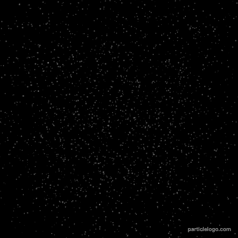

# particle-logo-canvas

Zero-dependency HTML5 2D Canvas logo particle animation micro-runtime (~3 KB minified). Samples any transparent SVG/image or `[x, y]` point list into 60FPS interactive particles with hover repulsion and click shockwaves.

Need the visual studio, 9 physics engines, 3,400+ searchable brand icons, or 1-click **Vue 3 / React / GIF / 4K Video** export?
👉 **[Open Particle Logo Workbench](https://particlelogo.com/workbench)** · **[Browse Live Tech Brand Templates](https://particlelogo.com/templates)**

## Why 2D Canvas instead of Lottie or Three.js?

| Approach | Typical Runtime + Asset Size | Interactive Physics (Hover/Click) | Setup |
| :--- | :--- | :--- | :--- |
| Lottie (`lottie-web`) | ~250 KB+ player + JSON | Static keyframe playback | After Effects / Bodymovin |
| Three.js WebGL | ~500 KB+ bundle | Custom shaders needed | Scene, camera, buffers |
| **Particle Logo Canvas** | **~3–13 KB gzipped total** | **Built-in repulsion & shockwaves** | **Drop in 1 script or component** |

## Quick Start

Open `index.html` locally in any browser (or serve with `npx serve .`), or import `createParticleLogo` in your app:

```html
<div id="logo-stage" style="width: 420px; height: 420px;"></div>
<script type="module">
  import { createParticleLogo, sampleSvgPath } from './particle-logo.js';

  // Sample any SVG path (24x24 viewBox) or pass your own [x, y, color?] coordinates
  const points = sampleSvgPath('m12 1.608 12 20.784H0Z');

  const instance = createParticleLogo(document.getElementById('logo-stage'), {
    points,
    variant: 'condense', // 'condense' | 'mobius-flow' | 'vortex'
    duration: 2.8,
    colors: ['#ffffff', '#e4e4e7', '#94a3b8']
  });
</script>
```

## Full Visual Generator & All 9 Physics Engines

This open-source micro-runtime includes 3 core physics presets (`condense`, `mobius-flow`, `vortex`). For the complete toolkit—including smart PNG/SVG/JPG/WebP sampling, mask debugging, **9 physics laws** (`Diffusion Denoise`, `Hologram Raster Scan`, `Superconducting Flux Wave`, `Autonomous Swarm Assembly`, `Slingshot Time Reversal`, `Cymatics Resonance`), **3,400+ built-in brand icons**, and **GIF / 4K Video / Vue 3 / React / Framer** exports—use the browser studio:

- Studio Workbench: https://particlelogo.com/workbench
- Particle Text Generator: https://particlelogo.com/typography
- 24 Interactive Tech Stack Templates: https://particlelogo.com/templates
- Integration Guides (Next.js, Vue 3, Astro, Nuxt, GitHub README): https://particlelogo.com/guides

## License

MIT © [Particle Logo Studio](https://particlelogo.com)


