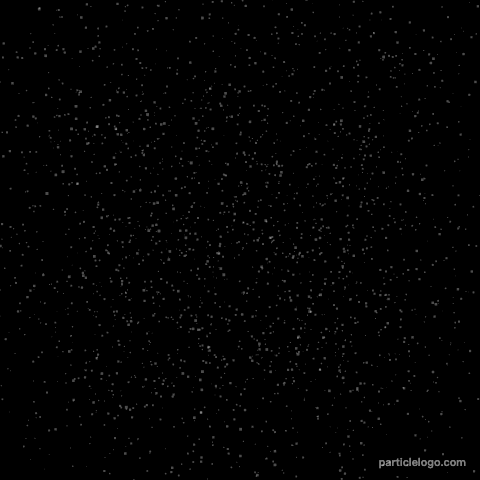

# particle-logo-canvas

[English](./README.md) · **简体中文**

零依赖、仅约 3 KB 的 HTML5 2D Canvas Logo 粒子动画微运行时。支持直接在浏览器离线采样 SVG 路径或 `[x, y]` 点集，生成 60FPS 交互式粒子聚集动画，并内置悬停排斥与点击径向冲击波交互。

> 需要上传任意 PNG/SVG/JPG/WebP 图片、从 **3,400+ 开源/科技品牌图标** 中直接挑选、使用全部 **9 种物理特效**，或一键导出 **GIF / 4K 透明视频 / Vue 3 / React** 组件？  
> 👉 **[打开 Particle Logo 在线工坊](https://particlelogo.com/zh/workbench)** · **[浏览 24 个在线技术品牌演示模板](https://particlelogo.com/zh/templates)**



---

## 为什么用 2D Canvas 代替 Lottie 或 Three.js？

对于官网首屏 Logo 揭幕或页面加载动画，传统方案往往体积过大：

| 方案 | 常见运行时 + 资源体积 | 鼠标交互（悬停排斥 / 点击冲击波） | 接入复杂度 |
| :--- | :--- | :--- | :--- |
| Lottie (`lottie-web`) | ~250 KB+ 播放器 + JSON | 静态时间轴播放，无物理交互 | 需 After Effects + Bodymovin 导出 |
| Three.js WebGL | ~500 KB+ 打包体积 | 需自行编写 Shader 与拾取逻辑 | 需维护 Scene / Camera / Buffer |
| **Particle Logo Canvas** | **~3 KB（完整导出组件约 ~6–13 KB gzip）** | **原生内置鼠标排斥与点击冲击波** | **引入单个 ES Module 文件即用** |

## 核心特性

- **零外部依赖**：纯原生 Canvas 2D API 与 `requestAnimationFrame`，不依赖 Three.js、GSAP 或 npm 构建链路。
- **离屏 SVG 路径采样**：`sampleSvgPath()` 通过离屏 Canvas + `Path2D` 按指定步长自动网格采样。
- **物理效果预设**：内置 `condense`（量子坍缩聚散）、`mobius-flow`（莫比乌斯行波）、`vortex`（螺旋吸积盘涡流）三种粒子运动方程。
- **实时鼠标交互**：指针悬停时自动排斥周围粒子，点击画布任意位置触发径向冲击波扩散。
- **自适应高清画布**：基于 `ResizeObserver` 自动适配容器尺寸与 `devicePixelRatio`（最高 2x）。

## 快速开始

下载本仓库后，直接任意静态服务器打开 `index.html`（例如 `npx serve .`），或在项目中作为 ES Module 引入：

```html
<div id="logo-stage" style="width: 420px; height: 420px;"></div>
<script type="module">
  import { createParticleLogo, sampleSvgPath } from './particle-logo.js';

  // 1. 从 24x24 坐标系 SVG Path 字符串采样点位
  const points = sampleSvgPath('m12 1.608 12 20.784H0Z', {
    size: 400,
    step: 5
  });

  // 2. 在容器内挂载 60FPS 粒子动画画布
  const instance = createParticleLogo(document.getElementById('logo-stage'), {
    points,
    variant: 'condense', // 'condense' | 'mobius-flow' | 'vortex'
    duration: 2.8,
    colors: ['#ffffff', '#e4e4e7', '#94a3b8'],
    particleSize: 2.0
  });
</script>
```

## API 说明

### `sampleSvgPath(svgPath, options?)`

| 参数 | 类型 | 默认值 | 说明 |
| :--- | :--- | :--- | :--- |
| `svgPath` | `string` | 必填 | SVG `<path d="...">` 路径字符串 |
| `options.size` | `number` | `400` | 离屏采样画布宽高（像素） |
| `options.viewBox` | `number` | `24` | SVG 原始坐标系边长（如 24×24） |
| `options.step` | `number` | `5` | 采样网格步长（越小粒子越密） |
| `options.padding` | `number` | `48` | 采样四周留白（像素） |

返回 `Array<[x, y]>` 坐标数组。

### `createParticleLogo(container, options?)`

| 参数 | 类型 | 默认值 | 说明 |
| :--- | :--- | :--- | :--- |
| `container` | `HTMLElement` | 必填 | 挂载 Canvas 的 DOM 容器 |
| `options.points` | `Array<[number, number, string?]>` | `[]` | 粒子目标坐标点阵（可选第 3 项指定单点十六进制颜色） |
| `options.variant` | `'condense' \| 'mobius-flow' \| 'vortex'` | `'condense'` | 粒子动画物理预设 |
| `options.duration` | `number` | `2.8` | 单轮重组耗时（秒） |
| `options.colors` | `string[]` | `['#ffffff', '#e4e4e7', '#94a3b8']` | 默认调色盘 |
| `options.particleSize` | `number` | `2.0` | 单个粒子像素尺寸 |

返回控制实例，包含三个方法：`instance.setVariant(next)`、`instance.replay()`、`instance.destroy()`。

## 完整视觉工坊与 9 种物理特效

本仓库开源了核心 2D Canvas 粒子动画微运行时与 3 种基础预设。如需处理透明背景抠图/自动裁剪包围盒、体验全部 **9 种物理定律特效**（含扩散去噪、全息扫描、超导磁通波、弹弓逆向重组、克拉尼驻波共振等）、从 **3,400+ 品牌图标库** 一键加载或导出 **GIF / 4K 透明视频 / Vue 3 / React** 代码，可直接在浏览器访问完整线上工坊（免登录即可试用核心功能）：

- 中文粒子工坊：https://particlelogo.com/zh/workbench
- 粒子文字生成器：https://particlelogo.com/zh/typography
- 24 个在线演示模板：https://particlelogo.com/zh/templates
- 框架接入指南：https://particlelogo.com/zh/guides

## 更新日志与协议

- 更新日志见 [CHANGELOG.md](./CHANGELOG.md)
- 开源协议：[MIT License](./LICENSE) © [Particle Logo Studio](https://particlelogo.com)
